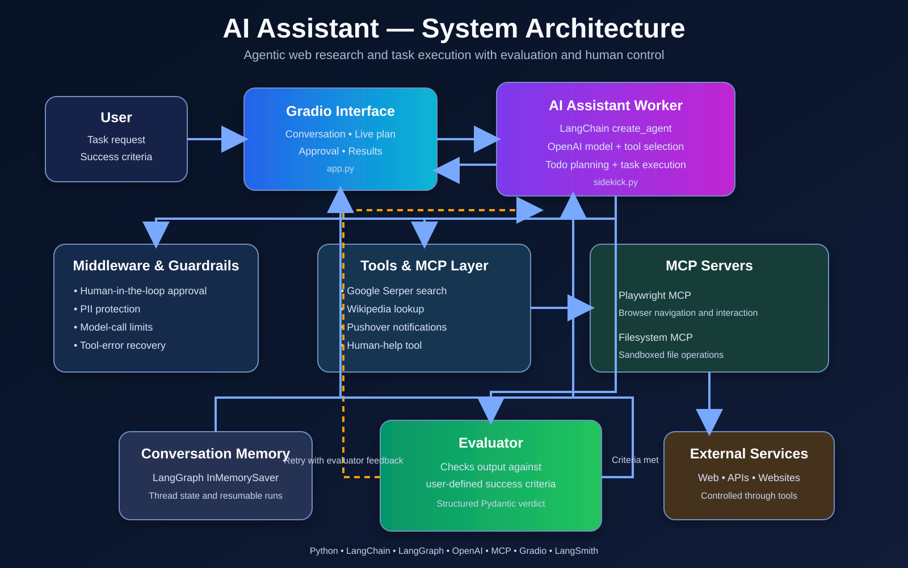
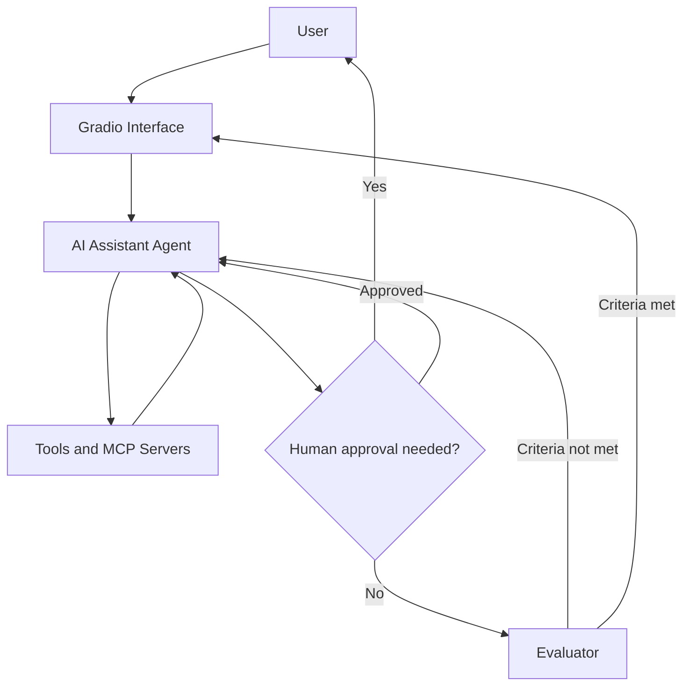
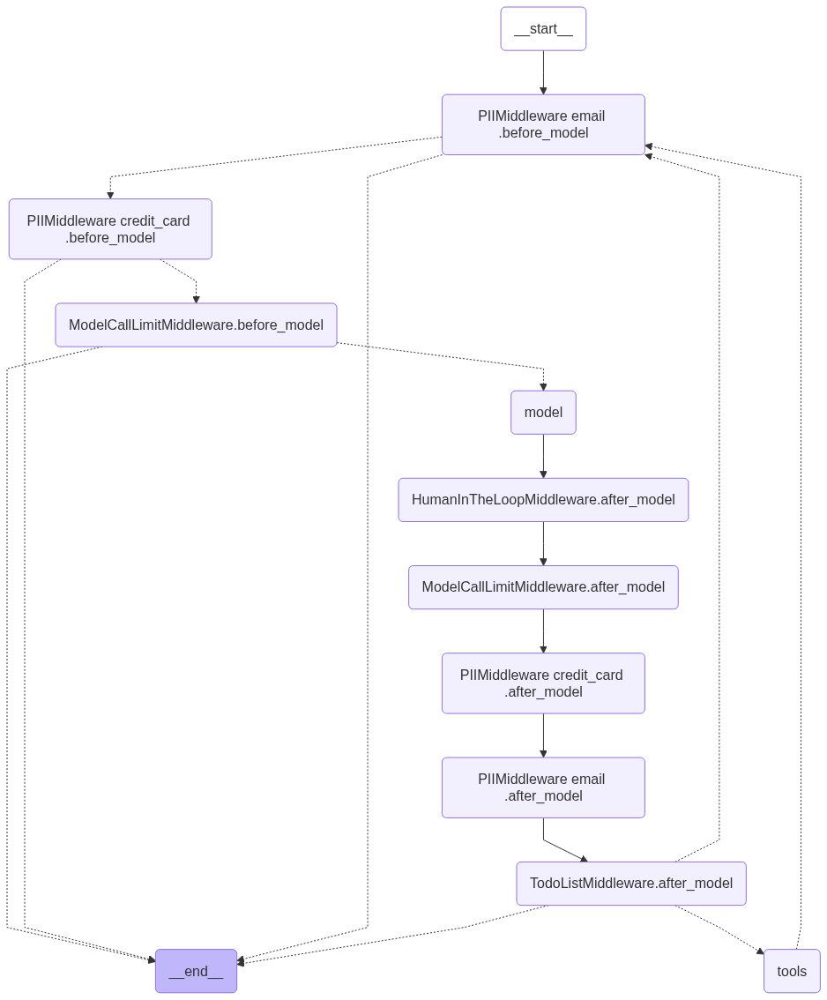

# AI Assistant

AI Assistant is an agentic web research and task-execution application built with LangChain, LangGraph, MCP, and Gradio.

The assistant can plan multi-step tasks, search the web, browse websites, consult Wikipedia, create files in a sandbox, and send push notifications. It includes an evaluator loop that checks completed work against user-defined success criteria and asks the agent to improve its response when necessary.

Sensitive actions require human approval before execution, giving the user control while allowing the assistant to work autonomously.

## Key Features

- **Agentic task execution** — completes multi-step tasks using a LangChain `create_agent` workflow.
- **Web research** — combines Google Serper search, Wikipedia, and browser automation.
- **Model Context Protocol (MCP)** — connects the agent to Playwright and sandbox filesystem tools.
- **Task planning** — creates and displays a live plan while the assistant works.
- **Evaluator loop** — evaluates results against user-defined success criteria and retries when improvements are needed.
- **Human-in-the-loop approval** — pauses before sensitive actions such as sending push notifications.
- **Guardrails** — includes PII protection, model-call limits, and tool-error recovery.
- **Conversation memory** — maintains context throughout the active user session.
- **Gradio interface** — provides an interactive UI for tasks, success criteria, plans, approvals, and results.

## Architecture





### Generated LangGraph Workflow



The application uses a worker-and-evaluator architecture:
1. The user submits a task and defines the success criteria.
2. The AI Assistant creates a plan and selects the appropriate tools.
3. MCP and LangChain tools perform web research, browser navigation, file operations, and notifications.
4. Sensitive actions pause for explicit human approval.
5. The evaluator checks the result against the success criteria.
6. If the result is insufficient, feedback is returned to the agent for another attempt.
7. The completed result is displayed in the Gradio interface.

## Technology Stack

| Technology | Purpose |
|---|---|
| Python 3.12+ | Core application language |
| LangChain | Agent creation, tools, middleware, and model integration |
| LangGraph | Agent state, memory, commands, and human-in-the-loop resumption |
| OpenAI | Reasoning, task execution, and structured evaluation |
| MCP | Standardized connection to external tools and services |
| Playwright MCP | Browser automation and website interaction |
| Filesystem MCP | Controlled access to the application sandbox |
| Google Serper | Web search |
| Wikipedia | Reference lookup |
| Gradio | Interactive web interface |
| Pydantic | Structured evaluator output |
| LangSmith | Agent tracing and observability |
| Pushover | Human-approved push notifications |
| uv | Dependency and environment management |

## Project Structure

```text
my-ai-assistant/
├── src/
│   └── my_ai_assistant/
│       ├── __init__.py
│       ├── app.py              # Gradio interface and application entry point
│       ├── sidekick.py         # Agent, middleware, evaluator, and workflow logic
│       ├── sidekick_tools.py   # Search, Wikipedia, notification, and MCP tools
│       ├── slide_kit.py        # Optional PowerPoint slide-generation template
│       ├── styles.py           # Gradio theme, CSS, and browser styling
│       └── sandbox/            # Runtime workspace for generated files
├── .env.example                # Required environment-variable template
├── .gitignore
├── pyproject.toml
├── uv.lock
└── README.md
```

## Prerequisites

Before running the application, install:

- Python 3.12 or later
- [uv](https://docs.astral.sh/uv/)
- Node.js and npm, which provide `npx` for launching the MCP servers
- An OpenAI API key
- A Google Serper API key
- A Pushover application token and user key for push notifications
- A LangSmith API key if tracing is enabled

## Local Installation

1. Clone the repository:

   ```powershell
   git clone https://github.com/konan1805/my-ai-assistant.git
   cd my-ai-assistant
   ```

2. Install the project dependencies:

   ```powershell
   uv sync
   ```

3. Create your local environment file:

   ```powershell
   Copy-Item .env.example .env
   ```

4. Open `.env` and add your API credentials. Never commit the completed `.env` file.

5. Start the application:

   ```powershell
   uv run my-ai-assistant
   ```

The Gradio interface will open automatically in your default browser.

## Example Tasks

The AI Assistant can handle requests such as:

- Research a topic across multiple web sources and summarize the findings.
- Compare products, services, companies, or technical solutions.
- Browse a website and extract specific information.
- Create a structured report and save it inside the sandbox.
- Search for travel options based on user-defined criteria.
- Use Wikipedia as an additional reference source.
- Send a push notification after completing an approved action.
- Pause and request human assistance when login, CAPTCHA, or two-factor authentication is required.

## Safety and Human Control

The AI Assistant includes several controls around autonomous execution:

- Push notifications require explicit user approval before they are sent.
- The workflow can pause when login, CAPTCHA, or two-factor authentication requires human assistance.
- PII middleware protects email addresses and credit-card information.
- Model-call limits help prevent uncontrolled execution and excessive API usage.
- Tool failures are returned to the agent so it can recover or try another approach.
- All filesystem operations are restricted to the application sandbox.
- API credentials are stored locally in `.env` and excluded from Git.

## Future Improvements

- Add persistent conversation memory across application restarts.
- Add user authentication and isolated workspaces for multiple users.
- Stream intermediate agent progress and tool activity to the interface.
- Add automated tests for tools, evaluator decisions, and approval flows.
- Improve source collection and citation formatting for research tasks.
- Add configurable models, tool permissions, and execution limits.
- Connect slide generation directly to the agent as a callable tool.
- Containerize and deploy the application to a hosted environment.
- Add production monitoring, structured logging, and usage metrics.

## What I Learned

This project helped me practice and apply:

- Building an agent with LangChain’s `create_agent` abstraction.
- Combining LangChain middleware with LangGraph state and checkpointing.
- Connecting agents to external capabilities through MCP.
- Designing a worker-and-evaluator feedback loop.
- Using success criteria to evaluate agent outcomes.
- Implementing human-in-the-loop approvals for sensitive actions.
- Handling external tool failures without terminating the workflow.
- Managing asynchronous MCP sessions and browser state.
- Building a live task-planning interface with Gradio.
- Separating agent logic, tools, presentation, and styling into maintainable modules.

## Author

**Arnaud Konan**

Lead Data Engineer transitioning into Agentic AI Engineering.

- [GitHub](https://github.com/konan1805)
- [LinkedIn](https://www.linkedin.com/in/arnaud-konan-539598193/)
- [AI Journey Portfolio](https://arnaud-ai.up.railway.app/)